# BUELM — Primary Source Data
**Department of Electronic Media | Bangalore University (Jnana Bharathi Campus)**  
*Archived Content, Structural Data, and Historical Assets from the Original Department Website (`bunews` / `jnanabharathitv.wixsite.com/bunews`)*

---

## Table of Contents
1. [Department Overview & Identity](#1-department-overview--identity)
2. [Vision & Mission Statements](#2-vision--mission-statements)
3. [Academic Programs & Courses](#3-academic-programs--courses)
   - [M.Sc. in Electronic Media](#31-msc-in-electronic-media)
   - [M.Sc. in Graphics and Animation](#32-msc-in-graphics-and-animation)
   - [M.Sc. in Film Making](#33-msc-in-film-making)
   - [Ph.D. in Electronic Media](#34-phd-in-electronic-media)
   - [Admission Process & Guidelines](#35-admission-process--guidelines)
4. [Infrastructure & Department Facilities](#4-infrastructure--department-facilities)
5. [Academic Activities, Student Productions & Practical Training](#5-academic-activities-student-productions--practical-training)
6. [Faculty & Academic Staff Directory](#6-faculty--academic-staff-directory)
7. [Alumni Association](#7-alumni-association)
8. [News, Events & Guest Lecture Archive (The Media Club)](#8-news-events--guest-lecture-archive-the-media-club)
9. [Official Contact Details & Social Media Links](#9-official-contact-details--social-media-links)
10. [Official Documents, Syllabi & Media Asset Repository](#10-official-documents-syllabi--media-asset-repository)
11. [Recommended Information Architecture for the New Website](#11-recommended-information-architecture-for-the-new-website)

---

## 1. Department Overview & Identity

| Attribute | Details |
| :--- | :--- |
| **Institution** | Bangalore University (Jnana Bharathi Campus) |
| **Department** | Department of Electronic Media |
| **Year of Establishment** | 2002 |
| **First Post-Graduate Batch** | 2002–2003 Academic Year (M.Sc. Electronic Media) |
| **Location** | Old Pareeksha Bhavana, Jnana Bharathi Campus, Bengaluru – 560056, Karnataka, India |
| **Department Coordinator** | Prof. Vahini Aravind (Professor &amp; Co-ordinator) |
| **Source Website (Archived)** | `https://jnanabharathitv.wixsite.com/bunews` |
| **Official Broadcaster / Tag** | Jnana Bharathi TV / BU News |

### Department Background
Growth in television channels, radio stations, and web-based media platforms has created a significant demand for skilled manpower to produce electronic media content using industry-standard technologies. To cater to this demand, Bangalore University established the Department of Electronic Media and launched the two-year M.Sc. in Electronic Media program in the 2002–03 academic year.

In the 2019–20 academic year, keeping in view the exponential growth of the entertainment, animation, and gaming industries in India and abroad, the Department expanded its academic offerings by introducing two specialized post-graduate programs:
1. **M.Sc. in Graphics and Animation**
2. **M.Sc. in Film Making**

The Department blends theory with hands-on studio practice, preparing students for dynamic careers across television news and entertainment networks, radio stations, film production companies, advertising and corporate communication agencies, digital media enterprises, and academia.

---

## 2. Vision & Mission Statements

### Vision Statement
> *"The Department of Electronic Media will impart media education, research, and training on par with international standards with advanced technology to construct the information-driven society. It will contribute ethically sensitive and socially responsible and empowered human resource to the field of mass media."*

### Mission Statement
- **Industry Readiness:** Train students to meet the requirements of electronic media organizations with special focus on television, cinema, radio, and new media.
- **Interdisciplinary Competence:** Educate students in the areas of advertising, corporate communication, media management, and media research.
- **Social Accountability:** Educate students to be socially responsible, culturally sensitive, ethically grounded, and legally sound professionals.

---

## 3. Academic Programs & Courses

### 3.1 M.Sc. in Electronic Media
*Self-Financing Master's Degree Program*

- **Established:** 2002–2003
- **Duration:** 2 Years (4 Semesters), Regular
- **Intake:** 35 Seats + 05 Payment Seats (Total: 40)
- **Eligibility:** Candidates who have passed any bachelor's degree examination from Bangalore University or any other recognized university with a minimum of 50% aggregate marks (5% relaxation for SC/ST students) are eligible to apply as per Bangalore University rules.
- **Core Curriculum & Practical Training:**
  - Television Production and Planning
  - Cinematography & Lighting
  - Sound Recording & Audio Engineering
  - Non-Linear Video Editing
  - Radio Program Production
  - Visual Communication & Presentation Techniques for Radio and TV
  - Web Journalism & New Media Technologies
  - News Gathering and Scriptwriting for Electronic Media
  - Advertising, Public Relations & Corporate Communication
  - Media Management & Media Ethics
  - Media Research Methodologies
  - **Mandatory Projects:**
    - 20-minute broadcast-standard documentary produced by each student/group.
    - News bulletin production and daily webcast.
    - 8-week to 4-month mandatory professional internship in leading media organizations at the end of the course.

### 3.2 M.Sc. in Graphics and Animation
*Advanced Technical & Creative Post-Graduate Degree*

- **Introduced:** Academic Year 2019–2020
- **Duration:** 2 Years (4 Semesters), Regular
- **Eligibility:** Any Bachelor's Degree with a minimum of 50% aggregate marks.
- **Course Focus:**
  - 2D and 3D Animation
  - Animated Movie Production
  - Character Technical Direction (TD)
  - Compositing and Audio-Visual Editing
  - 3D Simulation and Visual Effects (VFX)
  - 3D Modeling and Texturing
  - Graphic Design & Visual Identity
  - User Interface (UI) and User Experience (UX) Design

### 3.3 M.Sc. in Film Making
*Professional Cinematic Arts Post-Graduate Degree*

- **Introduced:** Academic Year 2019–2020
- **Duration:** 2 Years (4 Semesters), Regular
- **Eligibility:** Any Bachelor's Degree with a minimum of 50% aggregate marks.
- **Course Focus:**
  - Cinematography & Camera Techniques
  - Film Direction & Aesthetics
  - Film Appreciation & Cinematic History
  - Screenwriting, Scripting & Storyboarding
  - Film Editing & Color Grading
  - Sound Production, Dubbing & Foley Design
  - Graphics and Visual Effects in Cinema
  - Film Financing, Budgeting, Distribution & Marketing
  - Independent Short Film and Feature Production

### 3.4 Ph.D. in Electronic Media
*Advanced Doctoral Research Program*

- **Duration:** As per Bangalore University Ph.D. Regulations (2016 Regulations onwards)
- **Sanctioned Intake:** 12 Research Scholars
- **Nature of Program:** Full-time and Part-time
- **Eligibility:** As per Bangalore University Ph.D. Regulations.
- **Research Profile & Supervision:**
  - 3 Recognized Research Supervisors on faculty.
  - 5 Research Scholars successfully awarded Ph.D. degrees to date.
  - 13 Full-time and 3 Part-time active research scholars.
  - Faculty members actively undertake University and UGC Minor Research Projects.
  - Faculty and research scholars regularly publish research papers in peer-reviewed national/international journals and present papers at academic conferences.

### 3.5 Admission Process & Guidelines
- **System:** Centralized Online Admission System managed by Bangalore University.
- **Selection Criteria:** Strictly merit-based, governed by Bangalore University reservation norms and admission regulations.
- **Frequency:** Conducted annually through official notification released by the University Registrar.

---

## 4. Infrastructure & Department Facilities

| Facility | Description & Technical Equipment |
| :--- | :--- |
| **Television Production Studio** | State-of-the-art studio floor with multi-camera setup, teleprompters, studio lighting grid, master monitor walls, and broadcast-grade video switchers. |
| **Camera & Field Equipment** | Advanced cinematography equipment including high-definition (HD) broadcast cameras, aerial drone cameras, Canon 5D DSLR cameras, and professional field accessories. |
| **Audio & Radio Studio** | Dedicated sound recording, dubbing, and voice-over studio with audio mixing consoles, protocols, ENG field microphones, and multi-track portable digital audio recorders for radio program production. |
| **Mac Video Editing Lab** | State-of-the-art post-production lab equipped with Apple Mac workstations running Final Cut Pro (FCP), Avid, and the Adobe Creative Cloud suite. |
| **Computer & Multimedia Lab** | Networked computer lab with 10 Mbps broadband internet connectivity, dedicated to graphic design, animation rendering, 3D modeling, VFX, and new media web design. |
| **Department Library** | In-house specialized departmental library with **over 600–800 reference books** covering all aspects of electronic media, broadcasting, cinema, and journalism. |
| **Periodicals & Newspaper Archive** | Regular subscriptions to **over 30 specialized media periodicals/journals** and **over 20 leading daily newspapers** in English and Kannada. |
| **Documentary Archive** | Rich media library holding **over 1,000 national and international documentaries**, with direct access to television and radio broadcast archives. |
| **Smart Classrooms** | Technologically integrated classrooms equipped with high-definition digital projectors, high-speed Wi-Fi access, and Apple TV connectivity. |
| **Campus Security** | Round-the-clock CCTV surveillance across studios, labs, and department premises. |

---

## 5. Academic Activities, Student Productions & Practical Training

1. **BU News & Daily Webcast:**
   - As part of everyday practical training, students produce a daily **30-minute news magazine bulletin** ("BU News") and webcast it.
   - The Department handled the official live web streaming of the **52nd Bangalore University Annual Convocation**.
2. **Documentary Production:**
   - Every student conceives, researches, directs, and edits a broadcast-quality **20-minute documentary** as part of the curriculum.
3. **The Media Club:**
   - A weekly interactive forum where students interact with veteran media directors, editors, investigative journalists, wildlife filmmakers, and advertising leaders.
4. **Professional Internships:**
   - 8-week to 4-month industry internships in leading television news channels, entertainment studios, FM radio stations, digital media houses, and advertising agencies.
5. **Media Field Visits:**
   - Regular technical exposure visits to live broadcast news channels (e.g., Digvijaya News Channel), television production sets (e.g., Zee Kannada's *Comedy Kutumba*), printing presses, and studios.
6. **Workshops & Special Events:**
   - Regular masterclasses on visual effects (VFX), post-production, scriptwriting, National Press Day celebrations, and webinar series such as *Media Insights*.
7. **Wall Journals & Extension Projects:**
   - Publication of campus wall newspapers, student news bulletins, community extension reporting, and state/national media festival participation.

---

## 6. Faculty & Academic Staff Directory

### Permanent & Core Faculty

#### 1. Prof. Vahini Aravind
- **Designation:** Professor & Department Co-ordinator
- **Department:** Department of Electronic Media, Bangalore University
- **Photo URL:** `https://static.wixstatic.com/media/997389_e8e041033db74147a8c7fe50d8980bdf~mv2.jpg`
- **Official Profile Document (PDF):** [View Profile PDF](https://38ac8ce1-79bd-48c2-8059-02ee404f03b9.filesusr.com/ugd/997389_2eb92e5e183646729f3df4c755196ef4.pdf)

#### 2. Prof. Rajeshwari R.
- **Designation:** Professor
- **Department:** Department of Electronic Media, Bangalore University
- **Photo URL:** `https://static.wixstatic.com/media/997389_17d0339e8ab046629907be68be588615~mv2.jpg`
- **Official Profile Document (PDF):** [View Profile PDF](https://38ac8ce1-79bd-48c2-8059-02ee404f03b9.filesusr.com/ugd/997389_ef43638125314131b6f3658ef664989e.pdf)

#### 3. Dr. T. Sripathy
- **Designation:** Assistant Professor
- **Department:** Department of Electronic Media, Bangalore University
- **Photo URL:** `https://static.wixstatic.com/media/997389_39d68e50ab8e4145ba99cf79aed00a33~mv2.png`
- **Official Profile Document (PDF):** [View Profile PDF](https://38ac8ce1-79bd-48c2-8059-02ee404f03b9.filesusr.com/ugd/997389_0f7276058dc249dda1d333e9c62d24cf.pdf)

---

### Guest Faculty

#### 4. Dr. Krishna
- **Designation:** Guest Faculty
- **Department:** Department of Electronic Media, Bangalore University
- **Photo URL:** `https://static.wixstatic.com/media/997389_280662c5551749dead29a10ae9009277~mv2.jpg`

#### 5. Mr. Babu Yadav
- **Designation:** Guest Faculty
- **Department:** Department of Electronic Media, Bangalore University
- **Photo URL:** `https://static.wixstatic.com/media/997389_14e9d9ffb93e4b058ebb5297fec800a9~mv2.jpg`

#### 6. Mr. Praveen Malnad
- **Designation:** Guest Faculty
- **Department:** Department of Electronic Media, Bangalore University
- **Photo URL:** `https://static.wixstatic.com/media/997389_a6769f57c57a4631b8dce51197e614d2~mv2.jpg`

---

## 7. Alumni Association

- **Organization Name:** Alumni Association of The Department of Electronic Media, Bangalore University
- **Association Tagline:** *"Keeping Connection Between Old and Young"*
- **Purpose:** Connect alumni with the university campus, facilitate alumni-student mentorship, provide placement guidance, and celebrate professional milestones.
- **Alumni Footprint:** Graduates of the department hold prominent positions in Kannada, English, and regional television news channels, entertainment satellite networks, All India Radio and private FM stations, advertising creative agencies, public relations consultancies, feature film production units, animation houses, and higher education institutions.
- **Alumni Mentorship Highlights:** Department alumni frequently return as guest speakers and mentors (e.g., Ms. Manasa Chinnaswamy, entertainment producer).

---

## 8. News, Events & Guest Lecture Archive (The Media Club)

### Article 1: Field Visit to "Zee Kannada" Sets
- **Date:** September 15, 2017
- **Source Link:** `single-post/2017/09/15/field-visit-zee-kannada/`
- **Guest / Resource Person:** Satish, Program Director of *Comedy Kutumba* (Zee Kannada)
- **Key Takeaways & Summary:**
  > *"It's not an individual work, it's a team work."* — Satish, Program Director
  - Electronic media students visited the sets of Zee Kannada's reality entertainment show *Comedy Kutumba*.
  - Students observed live multicam floor operations, directional cues, set coordination, and post-shoot workflows.

### Article 2: The Media Club — Interaction with Alumna Manasa Chinnaswamy
- **Date:** October 12, 2017
- **Source Link:** `single-post/2017/10/12/the-media-club/`
- **Guest Speaker:** Ms. Manasa Chinnaswamy, Alumna & Entertainment Television Professional (6+ years experience)
- **Key Takeaways & Summary:**
  - Discussed the inner workings of commercial entertainment channels.
  - Addressed how target demographics dictate script storylines, the development of creative concepts, and managing unforeseen production/post-production challenges.

### Article 3: Memorable Day — Visit by Veteran Mass Communication Professors
- **Date:** December 22, 2017
- **Source Link:** `single-post/2017/12/22/memorable-day/`
- **Distinguished Visitors:** Prof. H. S. Eswara, Prof. Leela Rao, Prof. Balasubramanya, and Prof. Amjed Ahmad.
- **Key Takeaways & Summary:**
  - A milestone day for the Department of Electronic Media as four towering figures of Indian media and mass communication education visited the studios and interacted with the faculty and research scholars.

### Article 4: A Special Lecture by Prof. Srinivas Melkote
- **Date:** Delivered March 26–27, 2018 | Published April 12, 2018
- **Source Link:** `single-post/2018/04/12/a-special-lecture-by-prof-srinivas-melkote/`
- **Guest Speaker:** Dr. Srinivas Melkote, Professor at Bowling Green State University, Ohio, USA; Author of *Communication for Development: Theory and Practice for Empowerment and Social Justice*.
- **Key Takeaways & Summary:**
  - Explored ideological concepts surrounding "Third World" development, communication models, and social transformation.
  - Emphasized that social change is an open-ended, contested, and political process.
  - Advised on the urgent necessity of digital media literacy and balanced digital media regulation without undermining free speech.

### Article 5: Special Lecture by Shri D. P. Satish (Senior Editor, CNN-News18)
- **Date:** Delivered April 7, 2018 | Published April 12, 2018
- **Source Link:** `single-post/2018/04/12/special-lecture-by-shri-d-p-satish-senior-editor-cnn-news18-eng/`
- **Guest Speaker:** Shri D. P. Satish, Senior Editor, CNN-News18 (English)
- **Key Takeaways & Summary:**
  - Addressed the distinction between maintaining personal ideological beliefs while upholding journalistic objectivity on the beat.
  - Discussed the mechanics of propaganda, deliberate manufactured news versus reporting inaccuracy, and the epidemic of fake news.
  - Encouraged media students to cultivate broad, voracious reading habits across diverse genres.

### Article 6: Special Lecture by Shri Padmaraj Dandavati (Senior Journalist & Writer)
- **Date:** Delivered April 11, 2018 | Published April 12, 2018
- **Source Link:** `single-post/2018/04/12/special-lecture-by-shri-padmaraj-dandavati-senior-journalist/`
- **Guest Speaker:** Shri Padmaraj Dandavati, Veteran Journalist, Columnist & Author
- **Key Takeaways & Summary:**
  - Critiqued the contemporary crises facing Indian electronic media following the 1991 economic liberalization.
  - Highlighted how advertising-driven 24/7 news channels marginalize rural and grassroots issues in favor of sensationalism, superstition, and urban consumerism.
  - Noted that print media retains relatively higher depth and called upon students to champion responsible public-interest journalism.

### Article 7: Media Club — Lecture on Strategic Advertising by Shri Ravikumar Parthasarathy
- **Date:** Delivered April 25, 2018 | Published May 7, 2018
- **Source Link:** `single-post/2018/05/07/media-club-a-special-lecture-by-shri-ravikumar-parthasarathy-director-client-services-dis/`
- **Guest Speaker:** Shri Ravikumar Parthasarathy, Director (Client Services) at Disha Communications, Bangalore (40+ years advertising industry veteran)
- **Key Takeaways & Summary:**
  - Analyzed the foundational differences between Strategic Advertising and Tactical Advertising.
  - Emphasized consumer aspiration mapping during client briefing sessions and conducted creative interactive problem-solving exercises with students.

### Article 8: Media Club — Wildlife Filmmaking Masterclass by Krupakar & Senani
- **Date:** Delivered April 23, 2018 | Published May 8, 2018
- **Source Link:** `single-post/2018/05/08/media-club-a-special-lecture-by-shri-krupakar-senani-wildlife-filmmakers/`
- **Guest Speakers:** Shri Krupakar & Shri Senani, Renowned Wildlife Filmmakers and Green Oscar Award Winners
- **Organized Jointly with:** Department of Environmental Science, Bangalore University
- **Key Takeaways & Summary:**
  - Shared insights from 25 years of wildlife filmmaking in the Western Ghats and Indian wilderness.
  - Addressed challenges of non-controlled documentary filmmaking, capturing authentic natural history without preachiness, and maintaining rigorous field safety and ethical forest practices.

### Article 9: Media Club — Special Lecture by Dr. H. S. Eswara
- **Date:** May 10, 2018
- **Source Link:** `single-post/2018/05/10/media-club-a-special-lecture-by-dr-hs-eswara-professor-rtd-dept-of-communication-bangalor/`
- **Guest Speaker:** Dr. H. S. Eswara, Professor (Retired), Department of Communication, Bangalore University
- **Summary:** Masterclass lecture on mass communication theory and academic research methodologies.

### Article 10: Field Visit to Digvijaya News Channel
- **Date:** February 26, 2019
- **Source Link:** `single-post/2019/02/26/field-visit-digvijaya-news-channel/`
- **Event Summary:** Practical industry visit to the central studios and production control room (PCR) of Digvijaya 24/7 Kannada News Channel in Bangalore.

### Article 11: National Press Day Celebration 2020
- **Date:** June 30, 2020 | Event: July 1, 2020 at 11:00 AM IST
- **Source Link:** `single-post/2020/06/30/press-day-2020/`
- **Platform:** Virtual Event via Zoom (Meeting ID: 970 1223 0136)
- **Summary:** University-wide observance and panel discussion on the evolving role of the press during times of global health and socio-political challenges.

### Article 12: National Webinar Series — "Media Insights"
- **Date:** August 12, 2020 at 5:00 PM IST
- **Source Link:** `single-post/2020/08/12/media-insights/`
- **Summary:** Inauguration of a national-level webinar series featuring conversations with prominent academicians and media practitioners on contemporary media research and practice.

---

### Additional Documented Media Club Workshops
- **Media Skills Enrichment Workshop:** 1-week intensive technical training workshop held from May 18 to May 23, 2020.
- **Masterclass on Post-Production & VFX:** Specialized workshop conducted on March 8, 2019.
- **Interactive Session with Senior Anchors:** Special Media Club session featuring prominent Kannada journalists and broadcast anchors Gaurish Akki and Somanna Machimada.

---

## 9. Official Contact Details & Social Media Links

### Physical Address
```text
Department of Electronic Media
Bangalore University, Jnana Bharathi Campus
Old Pareeksha Bhavana
Bengaluru – 560056, Karnataka, India
```

### Working Hours & Inquiry Timings
- **Days:** Monday to Saturday (as per University schedule)
- **Inquiry Window:** 10:30 AM – 4:30 PM IST

### Telecommunication Numbers
- **Office Landlines:**
  - `080 22961319`
  - `080 22961993`
- **Mobile Hotline:**
  - `+91 98441 29885`

### Official Electronic Mail (Email)
- Primary Inquiries: `electronicmediabu@gmail.com`
- Webcast & Department Email: `jnanabharathitv@gmail.com`

### Official Social Media & Broadcast Channels
- **YouTube Channel (Jnana Bharathi TV):** [Jnana Bharathi TV on YouTube](https://www.youtube.com/channel/UC8XXMQioFPDTNmtADRWCVkg/videos)
- **Facebook Official Page:** [Dept of Electronic Media Facebook](https://www.facebook.com/Dept-of-Electronic-Media-465265577191463/)
- **Twitter / X Handle:** [@jnanabharathitv](https://twitter.com/jnanabharathitv)

---

## 10. Official Documents, Syllabi & Media Asset Repository

### 10.1 Curricular Syllabi (PDF Downloads)
- **M.Sc. Electronic Media Syllabus (New):**  
  [Download EM.pdf](https://38ac8ce1-79bd-48c2-8059-02ee404f03b9.filesusr.com/ugd/997389_3c92bf1f14124c9094b92df71542e622.pdf)
- **M.Sc. Graphics and Animation Syllabus:**  
  [Download G&A.pdf](https://38ac8ce1-79bd-48c2-8059-02ee404f03b9.filesusr.com/ugd/997389_5f6f57c739ff4ca38d933e2973f5638f.pdf)
- **M.Sc. Film Making Syllabus:**  
  [Download FM.pdf](https://38ac8ce1-79bd-48c2-8059-02ee404f03b9.filesusr.com/ugd/997389_44616267fa9240cca11a497f9302a504.pdf)
- **Bangalore University Legacy Electronic Media Syllabus Portal:**  
  [Bangalore University Portal Syllabus Link](http://bangaloreuniversity.ac.in/wp-content/uploads/2014/12/Elec-Med-Syllabus.pdf)

### 10.2 Faculty Profiles (PDF Downloads)
- **Dr. Rajeshwari R. Curriculum Vitae:**  
  [Download Profile PDF](https://38ac8ce1-79bd-48c2-8059-02ee404f03b9.filesusr.com/ugd/997389_ef43638125314131b6f3658ef664989e.pdf)
- **Dr. Vahini Aravind Curriculum Vitae:**  
  [Download Profile PDF](https://38ac8ce1-79bd-48c2-8059-02ee404f03b9.filesusr.com/ugd/997389_2eb92e5e183646729f3df4c755196ef4.pdf)
- **Dr. T. Sripathy Curriculum Vitae:**  
  [Download Profile PDF](https://38ac8ce1-79bd-48c2-8059-02ee404f03b9.filesusr.com/ugd/997389_0f7276058dc249dda1d333e9c62d24cf.pdf)

### 10.3 High-Resolution Photographic & Banner Assets (Wix CDN)

#### Faculty & Leadership Portraits
- Dr. Rajeshwari R. (Assistant Professor & Co-ordinator):  
  `https://static.wixstatic.com/media/997389_17d0339e8ab046629907be68be588615~mv2.jpg`
- Dr. Vahini Aravind (Assistant Professor):  
  `https://static.wixstatic.com/media/997389_e8e041033db74147a8c7fe50d8980bdf~mv2.jpg`
- Dr. T. Sripathy (Assistant Professor):  
  `https://static.wixstatic.com/media/997389_39d68e50ab8e4145ba99cf79aed00a33~mv2.png`
- Dr. Krishna (Guest Faculty):  
  `https://static.wixstatic.com/media/997389_280662c5551749dead29a10ae9009277~mv2.jpg`
- Mr. Babu Yadav (Guest Faculty):  
  `https://static.wixstatic.com/media/997389_14e9d9ffb93e4b058ebb5297fec800a9~mv2.jpg`
- Mr. Praveen Malnad (Guest Faculty):  
  `https://static.wixstatic.com/media/997389_a6769f57c57a4631b8dce51197e614d2~mv2.jpg`

#### Studio, Facilities & Student Production Imagery
- Studio Floor & Camera Shooting Setup (3112x1240):  
  `https://static.wixstatic.com/media/997389_528b4240abaa46b2bb7dd54b326cd140~mv2_d_3112_1240_s_2.jpg`
- Audio Dubbing & Multi-track Voice Recording Studio (3360x2240):  
  `https://static.wixstatic.com/media/997389_6aa9c30f4042482496007f40ba99bc13~mv2_d_3360_2240_s_2.jpg`
- Department Infrastructure & Editing Lab (5184x3888):  
  `https://static.wixstatic.com/media/997389_1b86e6d60b8043b59ac9e3235d769779~mv2_d_5184_3888_s_4_2.jpg`
- Live Studio Floor Demonstration (4386x2846):  
  `https://static.wixstatic.com/media/997389_d489ffcb4b954e868297df689115a76e~mv2_d_4386_2846_s_4_2.jpg`
- Convocation Live Webcast & Control Station (4032x2320):  
  `https://static.wixstatic.com/media/997389_52992d05ace848159f832eef831ec3ec~mv2_d_4032_2320_s_2.jpg`
- Department Building & Campus Panorama (4640x2610):  
  `https://static.wixstatic.com/media/997389_77756e902a704af28bdc842fb67b74a6~mv2_d_4640_2610_s_4_2.jpg`
- Department Studio Banner (980x653):  
  `https://static.wixstatic.com/media/997389_c62e4575a19741cc8e052b74a0ea859f~mv2_d_3360_2240_s_2.jpg`
- Field Visit Digvijaya News Channel (Banner):  
  `https://static.wixstatic.com/media/997389_7cec0fddd2574705a0cf0af75faad98b~mv2_d_2979_1855_s_2.jpg`
- Guest Lecture by Prof. Srinivas Melkote (Banner):  
  `https://static.wixstatic.com/media/997389_12d7449951fb45a690d1108725025fbd~mv2.jpg`
- Department Portrait Poster (3900x5700):  
  `https://static.wixstatic.com/media/997389_7a016b3ed21246e6b21b1f0051a74d7d~mv2_d_3900_5700_s_4_2.jpg`

---

## 11. Recommended Information Architecture for the New Website

Based on the parsed assets and data points, the following Information Architecture (IA) is recommended for building the modern version of the BUELM website:

```mermaid
flowchart TD
    Home["Home Page"] --> About["About Us"]
    Home --> Academics["Academic Programs"]
    Home --> Faculty["Faculty & Research"]
    Home --> Facilities["Studios & Infrastructure"]
    Home --> StudentWork["Student Works & Productions"]
    Home --> NewsEvents["Events & Media Club"]
    Home --> Alumni["Alumni Portal"]
    Home --> Contact["Contact & Admissions"]

    About --> VisionMission["Vision & Mission"]
    About --> History["History & Coordinator's Desk"]

    Academics --> MSC_EM["M.Sc. Electronic Media"]
    Academics --> MSC_GA["M.Sc. Graphics & Animation"]
    Academics --> MSC_FM["M.Sc. Film Making"]
    Academics --> PHD["Ph.D. Research Program"]
    Academics --> Syllabi["Syllabi & Curriculum Downloads"]

    Faculty --> CoreFac["Core Faculty Profiles & CVs"]
    Faculty --> GuestFac["Guest & Visiting Faculty"]
    Faculty --> ResearchPubs["Research Publications & Scholars"]

    Facilities --> TVStudio["TV Production Studio"]
    Facilities --> RadioAudio["Audio Recording & Radio Lab"]
    Facilities --> PostMac["Mac Video Editing Suites"]
    Facilities --> Library["Department Library & Media Archive"]

    StudentWork --> BUNews["BU News Daily Webcasts"]
    StudentWork --> DocProjects["Student Documentaries & Films"]
    StudentWork --> FieldVisits["Industry Field Visits"]

    NewsEvents --> MediaClub["The Media Club Archives"]
    NewsEvents --> Workshops["Webinars, Press Day & Workshops"]
    NewsEvents --> Gallery["Photo & Video Gallery"]

    Alumni --> AlumniRegister["Alumni Registration Form"]
    Alumni --> AlumniStories["Alumni Spotlight & Stories"]

    Contact --> ContactInfo["Campus Location & Telephones"]
    Contact --> InquiryForm["Admission Inquiry Form"]
```



### Key Functional Requirements for the New Website:
1. **Responsive, Mobile-First Design:** Accessible across desktop, tablets, and mobile devices.
2. **Syllabus & Document Downloads:** Direct links to academic regulations, program guides, and faculty CVs.
3. **Multimedia Video Hub:** Integration with the official YouTube channel (`Jnana Bharathi TV`) to showcase student documentaries, short films, news bulletins, and webinar recordings.
4. **Alumni Network Registration:** Dynamic form to register alumni, collect current employment data, and foster mentorship.
5. **Admission Notification & Inquiries:** Prominent call-to-actions for annual admissions, eligibility check, and Bangalore University centralized admission portal links.


https://bangaloreuniversity.karnataka.gov.in/212/electronic-media/en

About the Department:

Department of Electronic Media started functioning from the academic year 2002-03. Bangalore University has created a unique Electronic Media course for post-graduate students in the science faculty. Since then, the department has trained hundreds of students, and its graduates have succeeded in various fields, including education and the media industries (news and entertainment channels, radio stations, corporate communication, production companies, and movies). The department has a cutting-edge television studio to give students hands-on training. It is equipped with post-production tools and a multi-camera setup. Students can receive training using radio production equipment, field news-gathering equipment, and computer lab amenities. Well-equipped classrooms that facilitate technology-based instruction give the course more value. The syllabus has been revised to refelct the latest developments in the electronic media field.

 

The department has initiated two professional courses to make Film Making and Animation training affordable to students. it is in the direction of developing state of the art facilities for professional training and B.Sc. multimedia started from 2021-22 academic year. Further department is offering Ph.D. programme in Electronic Media. The department is also training engineering students of University Vishweshwaraiah College of Engineering in Media Presentation and Regulations as part of ability enhancement in NEP course structure. Department is teaching open elective for the B.Sc. and B.Com Honors students in the Jnana Bharathi campus.

 

The department alumni work in various fields like international news agency, National and regional news channels, production houses, entertainment channels, political communication, public relation and corporate communication departments, advertising agencies, NGOs, FM and community radio at various capacities. Some of the alumni are teaching at higher education institutions and involved in research activities. Many of the alumni have pursued Ph.D.

 

The department is distinct in nature comparing to any other media institution in Karnataka due to its nature of admission. Majority of the students are from backward areas. Further considerable number of students are from SC/ST and backward classes. The students from rural, backward background have been trained and successfully placed. Many of the students who joined these courses are first generation to get in to higher education in their village/family.

Department has signed MOU with professional organisations and has collaboration with media academy to train students in advance technologies and placement.

Department has developed proposal to establish multimedia research centre. Department is one of the preferred electronic media degree among aspiring television journalists and media professionals across Karnataka.

 

Co-ordinator  : Dr. Vahini. A

Tenure: 15.04.2025 to next two years

 
Contact Details: 

Department of Electronic Media, 
Jnanabharathi Campus,
Bangalore University,
Bengaluru- 560056

Tel: 080 22961319 / 080 22961993

Department Website: https://jnanabharathitv.wixsite.com/bunews 

Sl. No	Name	Qualification	Designation	Specialization	View Profile
1	Dr. Vahini. A	M.S. Communication, PG Dip in Higher Education, Ph.D.	Professor	Research, New Media Technology, Presentation Techniques	 Profile
2	Dr. R. Rajeshwari	M.S. Communication, Ph.D	 Professor	Radio Production, Ad. & Corporate Communication, Reporting & Editing	 Profile


 

A. Course Offered:

 

1. M.Sc. in Electronic Media

2. M.Sc. in Film Making

3. M.Sc. in Graphics and Animation

4. Ph.D

 

 

B. Nature of Course:

 

 

1. M.Sc.- Semester Scheme (Regular)

 

2. Ph.D - Full Time & Part Time

 

 

C. Duration:

 

 

1. M.Sc.- 4 Semesters (2 years)

 

2. Ph.D - 3+2 years & 4+2 Years

 

 

D. Intake:

 

 

1. M.Sc. in Electronic Media 35 + Payment Seats -10

 

2. M.Sc. in Film Making-20 Seats

 

3. M.Sc. in Graphics and Animation-20 Seats

 

4. Ph.D-  6 students per guide

 

 

E. Eligibility:

 

 

1) Any Bachelor degree with 50% aggregate marks

 

2) Ph.D: A post graduate degree in Electronic Media, Journalism and Mass Communication, Communication and Media related courses


Regulation & Syllabus

M.Sc. in Electronic Media

M.Sc. in Film Making

M.Sc. in Graphics & Animation

 